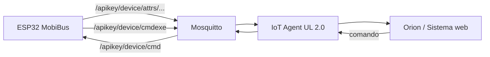

# MobiBus: firmware de monitoramento de frota

Firmware para ESP32 que monitora a temperatura interna e a do motor de um ônibus, permite que o motorista abra um alerta de quebra por um botão e envia tudo para o FIWARE por MQTT. O sistema web lê esses dados e pode resolver o alerta pelo mesmo canal.

## Sumário

1. [Links do projeto](#links-do-projeto)
2. [Arquitetura](#arquitetura)
3. [Estrutura da pasta](#estrutura-da-pasta)
4. [Hardware](#hardware)
5. [Como rodar no Wokwi](#como-rodar-no-wokwi)
6. [Configuração](#configuração)
7. [Comportamento](#comportamento)
8. [Integração FIWARE (MQTT)](#integração-fiware-mqtt)
9. [Saída no Serial](#saída-no-serial)
10. [Estrutura do código](#estrutura-do-código)
11. [Limitações conhecidas](#limitações-conhecidas)
12. [Pontos de melhoria](#pontos-de-melhoria)

## Links do projeto

| Item | Link |
|---|---|
| Simulação no Wokwi | [`Link da Simulação no Wokwi`](https://wokwi.com/projects/481124307203422209) |
| Dashboard hospedado na Vercel | [`Link do Site do MobiBus na Vercel`](https://mobi-bus-gs.vercel.app/) |
| Vídeo no YouTube | [`Link do Video no Youtube`](https://youtu.be/duI55tUqWwA) |
| Repositório do dashboard | [`Repositório do projeto MobiBus`](https://github.com/felippetuma/MobiBus-GS) |
| FIWARE original (professor Fabio Cabrini), só como referência | [ `Repositório FIWARE original`](https://github.com/fabiocabrini/fiware) |

## Arquitetura


O ESP32 publica telemetria por MQTT no Mosquitto, o IoT Agent a converte para o Orion e o Orion notifica o STH-Comet, que guarda o histórico. Os comandos fazem o caminho inverso: dashboard, Orion, IoT Agent, Mosquitto e ESP32. O Dashboard fica em outro repositório e aparece tracejado. Mais detalhes em [docs/visao-geral.md](docs/visao-geral.md).

## Estrutura da pasta

| Caminho | Função |
|---|---|
| `firmware/Mobibus/mobibus.ino` | Firmware completo (sensores, botão, buzzer, Wi-Fi, MQTT) |
| `wokwi/diagram.json` | Circuito do Wokwi (ESP32 DevKit, 2 DHT22, buzzer, botão) |
| `wokwi/libraries.txt` | Bibliotecas que o Wokwi instala: `PubSubClient` e `DHT sensor library for ESPx` |
| `fiware/` | Stack FIWARE: `docker-compose.yml`, Mosquitto e Nginx. Baseada no [repositório do professor Fabio Cabrini](https://github.com/fabiocabrini/fiware), com o Nginx acrescentado. Use esta pasta, não o original |
| `docs/` | Documentação completa, com os links do Wokwi, do dashboard na Vercel, do vídeo no YouTube e do repositório do dashboard ([docs/README.md](docs/README.md)) |
| `README.md` | Este documento |

## Hardware

| Componente | Pino do ESP32 | Constante | Observação |
|---|---|---|---|
| DHT22 "Sensor Interno" | GPIO 22 | `PIN_DHT_INTERNO` | Temperatura (e umidade) do interior do ônibus |
| DHT22 "Sensor Motor" | GPIO 21 | `PIN_DHT_MOTOR` | Temperatura do motor |
| Buzzer | GPIO 19 | `PIN_BUZZER` | Saída digital, tocado com `tone()` |
| Botão de alerta | GPIO 18 | `PIN_BOTAO` | `INPUT_PULLUP`; pressionado = LOW |

Alimentação: o VCC dos dois DHT22 vai em 3V3, e o GND dos DHT22, do buzzer e do botão vai em um GND comum (pela protoboard).

O `diagram.json` já reflete essa ligação.

## Como rodar no Wokwi

1. Crie um projeto ESP32 no Wokwi e importe `firmware/Mobibus/mobibus.ino`, `wokwi/diagram.json` e `wokwi/libraries.txt`.
2. Em `mobibus.ino`, use o Wi-Fi de teste do Wokwi:
   ```cpp
   #define WIFI_SSID      "Wokwi-GUEST"
   #define WIFI_PASSWORD  ""
   ```
3. Aponte `MQTT_BROKER` para um Mosquitto acessível pela internet (o Wokwi não alcança `localhost`).
4. Inicie a simulação e abra o monitor serial (115200 baud).

Para testar:

- **Alerta do botão:** clique no botão vermelho. O Serial mostra `ALERTA: acionado pelo motorista` e o buzzer toca três bips a cada segundo.
- **Alarme de temperatura interna:** clique no `dht1` e suba a temperatura acima de 35 °C.
- **Alarme do motor:** o DHT22 chega no máximo a 80 °C, então o limite padrão de 79 °C só dispara na faixa de 79,1 a 80 °C. Para testar no Wokwi, ajuste o `dht2` para 79,5 °C ou mais.

## Configuração

Tudo fica no topo de `mobibus.ino`.

| Constante | Padrão | Descrição |
|---|---|---|
| `WIFI_SSID`, `WIFI_PASSWORD` | placeholders | Credenciais do Wi-Fi. Não versione credenciais reais. |
| `MQTT_BROKER`, `MQTT_PORT` | `fiware_server_ip`, `1883` | Broker Mosquitto |
| `MQTT_USER`, `MQTT_PASSWORD` | vazios | Deixe `MQTT_USER` vazio para conectar sem autenticação |
| `APIKEY` | `TEF` | Deve ser igual ao service group do IoT Agent |
| `DEVICE_ID` | `onibus001` | ID do ônibus; deve ser igual ao device provisionado |
| `TEMP_INTERNA_MAX` | `35.0` °C | Acima disso, dispara o alarme da temperatura interna |
| `TEMP_MOTOR_MAX` | `79.0` °C | Acima disso, dispara o alarme do motor |
| `DEBOUNCE_BOTAO_MS` | `50` | Debounce do botão |
| `INTERVALO_LEITURA_MS` | `2000` | Período de leitura dos DHT22 (nunca abaixo do mínimo do sensor) |
| `INTERVALO_PUB_SENSORES` | `5000` | Publicação de `t`, `m`, `h`, `p1`..`p6` e `a` |
| `INTERVALO_PUB_ESTADO` | `10000` | Republicação periódica de `s` |
| `INTERVALO_RECONEXAO` | `5000` | Tentativas de MQTT |
| `INTERVALO_RECONEXAO_WIFI` | `10000` | Tentativas de Wi-Fi |

Dependências (Arduino IDE, Gerenciador de Bibliotecas): `PubSubClient` 2.8 ou superior (por causa do `setBufferSize`) e `DHT sensor library for ESPx` (`DHTesp`).

## Comportamento

### Leitura dos sensores

A cada 2 s o firmware lê os dois DHT22, sem `delay()` bloqueante. Se um sensor devolve `NaN` ou erro, a leitura é ignorada e o erro vai para o Serial. Enquanto um sensor estiver inválido, o atributo dele deixa de ser publicado.

### Alerta do botão

1. O motorista aperta o botão. Depois do debounce de 50 ms, a borda de descida liga `alertaAtivo`.
2. O buzzer toca o padrão de alerta e o atributo `a` passa a `true`.
3. O alerta só cai quando o sistema web envia o comando `resolverAlerta`. Apertar de novo com o alerta ligado apenas registra uma linha no Serial.

### Alarme de temperatura

O buzzer também dispara quando a temperatura interna passa de `TEMP_INTERNA_MAX` ou a do motor passa de `TEMP_MOTOR_MAX`. O alarme termina sozinho quando a leitura volta ao normal.

### Prioridade e padrões sonoros

Se mais de uma condição estiver ativa, toca a de maior prioridade.

| Prioridade | Condição | Padrão | Repete a cada |
|---|---|---|---|
| 1 | Botão do motorista | 3 bips de 3000 Hz, 250 ms | 1 s |
| 2 | Temperatura interna (ou `alertTemp` remoto) | 2 bips de 1800 Hz, 180 ms | 1,8 s |
| 3 | Temperatura do motor | 1 bip longo de 1000 Hz, 500 ms | 1,8 s |

## Integração FIWARE (MQTT)

O firmware usa o protocolo UltraLight 2.0 do IoT Agent, com Mosquitto como broker. `<apikey>` é `APIKEY` e `<device>` é `DEVICE_ID`.



### Publicação

| Tópico | Payload | Descrição |
|---|---|---|
| `/<apikey>/<device>/attrs/t` | `25.3` | Temperatura interna (°C) |
| `/<apikey>/<device>/attrs/h` | `48.0` | Umidade interna (%), lida pelo DHT22 interno |
| `/<apikey>/<device>/attrs/m` | `88.4` | Temperatura do motor (°C) |
| `/<apikey>/<device>/attrs/p1` ... `p6` | `110.3` | Pressão simulada de cada pneu (PSI): p1/p2 dianteiros esq./dir., p3/p4 traseiros esq., p5/p6 traseiros dir. |
| `/<apikey>/<device>/attrs/a` | `true` ou `false` | Status do alerta do botão |
| `/<apikey>/<device>/attrs` | `s\|on` ou `s\|off` | Estado do buzzer |

- `t`, `h`, `m`, `p1`..`p6` e `a` saem a cada 5 s e ao conectar no broker.
- `a` também sai assim que muda (botão apertado ou alerta resolvido).
- `s` sai ao mudar, a cada 10 s e depois de cada comando.

Não há timestamp na mensagem. A pressão dos pneus é simulada (sem sensor). O ID do ônibus é o `DEVICE_ID`, que já vai nos tópicos.

### Comandos

O firmware assina `/<apikey>/<device>/cmd`. O formato é `<device>@<comando>|<parâmetros>`. Comandos para outro `device_id` são ignorados.

| Comando | Efeito |
|---|---|
| `resolverAlerta` | Derruba o alerta aberto pelo botão |
| `alertTemp` | Força o alarme de temperatura. O firmware o zera a cada leitura sem alarme local, então com sensores normais ele dura cerca de 2 s |
| `alertOff` | Cancela o alarme remoto de temperatura |
| `buzzer_on` | Buzzer em tom contínuo |
| `buzzer_off` | Silencia o buzzer até a anomalia atual terminar |

A resposta vai em `/<apikey>/<device>/cmdexe` como `<device>@<comando>|ok` ou `<device>@<comando>|unknown command`. Depois de cada comando, o firmware republica `a` e `s`.

Exemplo, usando o cliente do Mosquitto:

```bash
mosquitto_pub -h <broker> -t "/TEF/onibus001/cmd" -m "onibus001@resolverAlerta|"
```

### Provisionamento no IoT Agent

O device precisa de `t`, `h`, `m`, `p1`..`p6`, `a` e `s` como atributos e dos cinco comandos acima. Exemplo (ajuste hosts, portas e `fiware-service`):

```bash
curl -X POST "http://<iot-agent>:4041/iot/devices" \
  -H "fiware-service: smart" -H "fiware-servicepath: /" \
  -H "Content-Type: application/json" -d '{
    "devices": [{
      "device_id": "onibus001",
      "entity_name": "urn:ngsi-ld:Onibus:001",
      "entity_type": "Onibus",
      "protocol": "PDI-IoTA-UltraLight",
      "transport": "MQTT",
      "attributes": [
        {"object_id": "t", "name": "temperaturaInterna", "type": "Number"},
        {"object_id": "h", "name": "umidadeInterna", "type": "Number"},
        {"object_id": "m", "name": "temperaturaMotor", "type": "Number"},
        {"object_id": "p1", "name": "pressaoPneu1", "type": "Number"},
        {"object_id": "p2", "name": "pressaoPneu2", "type": "Number"},
        {"object_id": "p3", "name": "pressaoPneu3", "type": "Number"},
        {"object_id": "p4", "name": "pressaoPneu4", "type": "Number"},
        {"object_id": "p5", "name": "pressaoPneu5", "type": "Number"},
        {"object_id": "p6", "name": "pressaoPneu6", "type": "Number"},
        {"object_id": "a", "name": "alerta", "type": "Text"},
        {"object_id": "s", "name": "buzzer", "type": "Text"}
      ],
      "commands": [
        {"name": "resolverAlerta", "type": "command"},
        {"name": "alertTemp", "type": "command"},
        {"name": "alertOff", "type": "command"},
        {"name": "buzzer_on", "type": "command"},
        {"name": "buzzer_off", "type": "command"}
      ]
    }]
  }'
```

Esse exemplo é um ponto de partida: os nomes das entidades e dos atributos NGSI (`temperaturaInterna` e os demais) são sugestões minhas, e o service group precisa usar o mesmo `APIKEY` do firmware.

## Saída no Serial

Velocidade de 115200 baud. Exemplos de linhas:

```
Temperatura interna: 27.4 C
Umidade interna: 52.0 %
Temperatura do motor: 85.1 C
STATUS: OPERACAO NORMAL
ALERTA: acionado pelo motorista (onibus com problema)
Alerta sonoro: BOTAO DO MOTORISTA
ALARME: TEMPERATURA INTERNA ACIMA DO LIMITE!
ERRO: Falha na leitura do DHT motor: ...
-> /TEF/onibus001/attrs/t 27.4 (true)
<- /TEF/onibus001/cmd onibus001@resolverAlerta|
ALERTA: resolvido pelo sistema web
```

`->` indica publicação (com o retorno do `publish`) e `<-` indica mensagem recebida.

## Estrutura do código

| Trecho de `mobibus.ino` | Função |
|---|---|
| Configuração e pinos | Constantes de rede, FIWARE, pinos e limites |
| `connectWiFi()`, `connectMqtt()`, `manterConexoes()` | Reconexão sem bloqueio, uma tentativa por intervalo |
| `publicarSensores()`, `publicarAlerta()`, `publicarEstado()` | Publicação dos atributos |
| `executarComando()`, `onMessage()` | Interpretação dos comandos e confirmação em `cmdexe` |
| `lerBotao()` | Debounce e detecção de borda |
| `lerDht()`, `lerSensores()` | Leitura dos DHT22, tratamento de `NaN` e cálculo dos alarmes |
| `controlarAlertas()` | Escolha do padrão sonoro pela prioridade |
| `emitirSom()`, `atualizarSom()` | Sequência de tons sem `delay()` |
| `loop()` | Orquestra tudo com `millis()` |

## Limitações conhecidas

- **Limite do motor:** o DHT22 lê de -40 a 80 °C, então o limite padrão de 79 °C fica a 1 °C do fundo de escala. Para um motor de verdade, é preciso outro sensor (por exemplo, termopar).
- **Alerta sem persistência:** `alertaAtivo` fica só na RAM. Se o ESP32 reiniciar, o alerta é perdido.
- **Alarme preso por sensor com defeito:** se um DHT22 falha depois de disparar o alarme, o alarme continua até uma leitura válida.
- **Silenciar o buzzer:** `buzzer_off` também silencia o alerta do botão até ele ser resolvido. O atributo `a` continua `true`.
- **Sem canal offline:** sem Wi-Fi ou MQTT, o alerta do botão não pode ser resolvido, porque só o comando remoto o derruba.
- **Sem testes automatizados** e sem compilação verificada fora do Wokwi.

## Pontos de melhoria

- Clique longo no botão para resolver o alerta quando estiver offline (já comentado no código).
- Timestamp nos dados, se o sistema web precisar.
- Alarme também para temperatura mínima.
- Persistir `alertaAtivo` na memória não volátil.
- Credenciais fora do código-fonte.

## Documentação

A pasta [docs/](docs/README.md) traz a documentação detalhada: visão geral, hardware, firmware, protocolo MQTT, manual de software, testes e limitações. O índice tem os campos para o link do Wokwi e para o repositório do dashboard.
